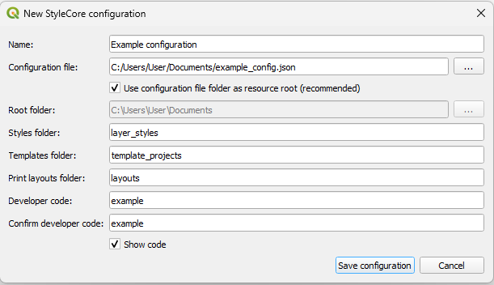
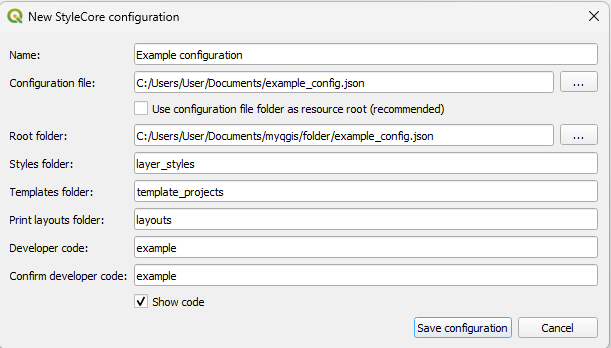
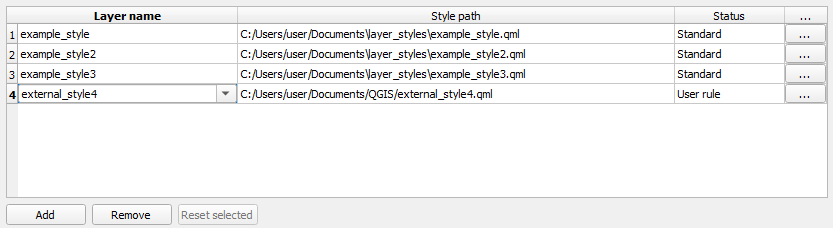
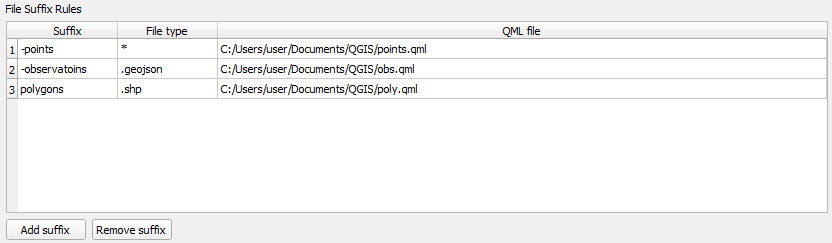
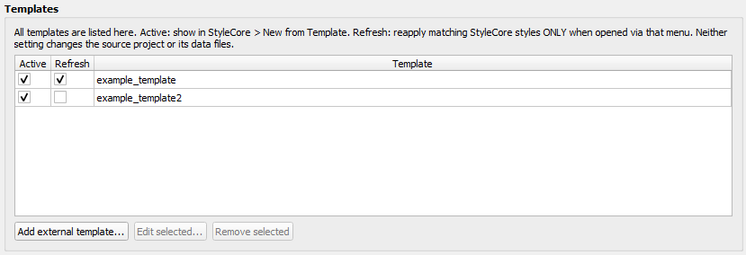
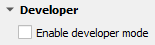
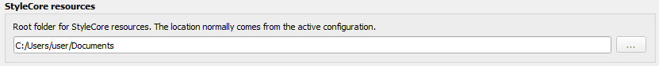

# Konfiguration JSON

StyleCore opretter og opdaterer sin JSON-konfiguration inde fra QGIS. Denne side er en **komplet reference** til, hvad der kan ligge i filen, og hvordan værdierne normalt vedligeholdes. Se [Konfiguration – i QGIS](configuration.md) for den praktiske arbejdsgang.

## 1. Hvad JSON-filen bruges til

JSON-filen gemmer den **fælles konfiguration**, som kolleger deler. Den kan indeholde:

- navn og identitet for konfigurationen,
- hvor den fælles rodmappe ligger,
- mappenavne til styles, templates og layouts,
- fælles regler for automatisk lagstyling,
- File Suffix Rules,
- template-indstillinger som **Active**, **Refresh** og **external templates**,
- samt developer-koden.

Den gemmer **ikke** hver brugers Personal Overrides. De bliver i den lokale QGIS-profil.

## 2. To hovedmønstre: simpel rodmappe vs. mere selvstændige regler

De fleste teams starter med en **enkel rodmappe-baseret opsætning**:

- `layer_styles` indeholder QML-filerne,
- `template_projects` indeholder templates,
- `layouts` indeholder QPT-filerne,
- og StyleCore finder selv matchende ressourcer ud fra rodmappe og mappenavne.

Når du har brug for mere kontrol, kan JSON-filen også gemme **eksplicitte regler**:

- et lagnavn kan pege på en bestemt QML-fil,
- en suffix-regel kan pege på en QML-fil,
- og en template kan refereres ved sti, selv om den ligger uden for template-mappen.

## 3. Eksempel på konfiguration

??? example "Vis JSON-eksempel"
    ```json
    {
      "name": "Office",
      "config_id": "unique-id-created-by-stylecore",
      "root_mode": "config_dir",
      "root_folder": "",
      "save_paths": "relative",
      "folders": {
        "styles": "layer_styles",
        "templates": "template_projects",
        "layouts": "layouts"
      },
      "style_rules": [
        {"layer": "Buildings", "style": "Buildings.qml"},
        {"layer": "Survey points", "style": "custom/survey_points.qml"}
      ],
      "file_suffix_styles": [
        {"suffix": "-survey", "extension": ".geojson", "style_filename": "Survey.qml"},
        {"suffix": "-points", "extension": "*", "style_filename": "QGIS/points.qml"}
      ],
      "external_templates": [
        {"name": "Regional Map", "path": "other_projects/region.qgz"}
      ],
      "inactive_templates": ["Archive/Old_Map"],
      "restyle_on_open": ["Base_Map", "Regional Map"],
      "developer_code": "replace-with-your-own-code"
    }
    ```

## 4. Komplet forklaring af felter

| Felt | Betydning | Hvordan vedligeholdes det normalt? |
|---|---|---|
| `name` | Visningsnavn i QGIS | Angives ved oprettelse |
| `config_id` | Intern ID, som adskiller lokale valg mellem konfigurationer | Laves automatisk af StyleCore |
| `root_mode` | Bestemmer om rodmappen kommer fra JSON-mappen (`config_dir`) eller en separat sti (`custom`) | Angives ved oprettelse |
| `root_folder` | Absolut rodmappe når `root_mode` er `custom` | Vedligeholdes i Developer-indstillinger |
| `folders.styles` | Navn på styles-undermappen | Angives ved oprettelse |
| `folders.templates` | Navn på templates-undermappen | Angives ved oprettelse |
| `folders.layouts` | Navn på layouts-undermappen | Angives ved oprettelse |
| `save_paths` | Om projekter lavet fra templates foretrækker relative eller absolutte stier | Vedligeholdes i JSON / konfiguration |
| `style_rules` | Fælles regler fra lagnavn til QML | Vedligeholdes i Developer → Shared automatic layer styles |
| `file_suffix_styles` | Regler fra suffix + filtype til QML | Vedligeholdes i Developer → File Suffix Rules |
| `external_templates` | Navngivne template-referencer uden for normal template-mappe | Vedligeholdes i Developer → Templates |
| `inactive_templates` | Template-ID'er der skal skjules i **New from Template** | Vedligeholdes via **Active** i Templates-tabellen |
| `restyle_on_open` | Template-ID'er som skal genanvende styles ved åbning gennem StyleCore | Vedligeholdes via **Refresh** i Templates-tabellen |
| `developer_code` | Bekræftelseskode ved fælles ændringer | Angives ved oprettelse |

## 5. Forstå rodmappe-indstillingerne

### `root_mode: "config_dir"`

Det betyder, at **mappen med JSON-filen** er rodmappen.

{ width="78%" }
*Når denne mulighed er slået til, fungerer konfigurationsfilens mappe også som rodmappe for ressourcer.*

### `root_mode: "custom"`

Det betyder, at JSON-filen peger på en **separat rodmappe**.

{ width="78%" }
*Brug en custom root, når de fælles ressourcer skal ligge et andet sted end selve JSON-filen.*

## 6. Forstå fælles style-regler

Hvis en QML-fil allerede ligger i styles-mappen og matcher lagnavnet, behøver du ingen ekstra regel. Men hvis lagnavn og QML-filnavn er forskellige, gemmes en regel i `style_rules`.

En simpel regel kan fx se sådan ud:

```json
"style_rules": [
  {"layer": "Buildings", "style": "Buildings.qml"}
]
```

En mere selvstændig regel kan pege på et andet navn eller en QML-fil i en anden undermappe:

```json
"style_rules": [
  {"layer": "Survey points", "style": "custom/survey_points.qml"},
  {"layer": "Road centerline", "style": "roads/centreline.qml"}
]
```

{ width="92%" }
*Shared automatic layer styles vedligeholdes i Developer og skrives derefter til `style_rules` i JSON-filen.*

## 7. Forstå File Suffix Rules

File Suffix Rules gemmes i `file_suffix_styles`. De bruges, når et lag skal styles ud fra **kildens filnavn**, ikke kun det synlige lagnavn.

Eksempel:

```json
"file_suffix_styles": [
  {"suffix": "-points", "extension": "*", "style_filename": "QGIS/points.qml"},
  {"suffix": "-observations", "extension": ".geojson", "style_filename": "QGIS/obs.qml"},
  {"suffix": "polygons", "extension": ".shp", "style_filename": "QGIS/poly.qml"}
]
```

{ width="92%" }
*Hver File Suffix Rule gemmer et suffix, en filtype og en mål-QML.*

## 8. Forstå templates i JSON-filen

Templates kommer normalt fra den valgte template-mappe. I så fald skal JSON-filen kun holde styr på, om de er **Active** og **Refresh**.

Hvis en template skal ligge et andet sted, gemmes den i `external_templates`.

Eksempel:

```json
"external_templates": [
  {"name": "Regional Map", "path": "other_projects/region.qgz"},
  {"name": "Field package", "path": "D:/GIS/field_package.qgz"}
]
```

`inactive_templates` gemmer templates, som **ikke** skal vises i **New from Template**.

`restyle_on_open` gemmer templates, som skal genanvende matchende styles, når de åbnes gennem StyleCore.

{ width="92%" }
*Templates-tabellen styrer Active, Refresh og eksterne template-referencer.*

## 9. Sådan vedligeholder du JSON-filen sikkert

Normalt bør du **ikke redigere JSON-filen manuelt**, medmindre det er nødvendigt. Den foretrukne arbejdsgang er:

1. Indlæs den rigtige konfiguration.
2. Åbn **Settings → Options → StyleCore**.
3. Slå **Developer Mode** til, når du skal lave fælles ændringer.
4. Lav ændringen det rigtige sted.
5. Klik **Apply / OK** og bekræft med developer-koden.
6. Bed kolleger genindlæse konfigurationen, hvis det er nødvendigt.

Nyttige steder til vedligeholdelse:

{ width="82%" }
*Developer Mode åbner de fælles vedligeholdelsesområder.*

{ width="92%" }
*Brug rodmappe-sektionen, når en fælles mappe eller et drev skifter placering.*

JSON-filen vedligeholdes især gennem:

- **oprettelse af konfiguration** for root mode, mappenavne og developer-kode,
- **Developer → root folder** for en custom root,
- **Developer → Templates** for Active / Refresh / external templates,
- **Developer → Shared automatic layer styles** for `style_rules`,
- **Developer → File Suffix Rules** for `file_suffix_styles`.

## 10. Sikker manuel redigering

Hvis du alligevel skal redigere JSON-filen direkte:

1. Tag en backup først.
2. Hold JSON-filen gyldig.
3. Undgå at ændre `config_id`, medmindre StyleCore bevidst skal opfatte det som en anden konfiguration.
4. Bevar den relative struktur, hvis konfigurationen bruger `config_dir`.
5. Genindlæs konfigurationen i QGIS og test templates, styles og layouts bagefter.

Personal Overrides og brugerens valgte konfigurationssti ligger **ikke i den fælles JSON-fil**. De hører til i den lokale QGIS-profil.
