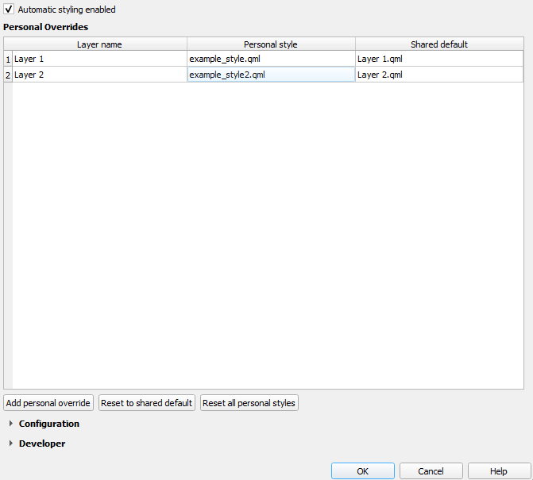
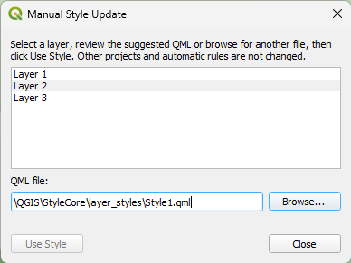
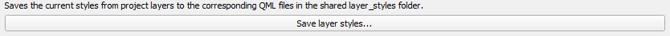

# Lagstyling

StyleCore bruger **QML-filer** til at style nye QGIS-lag ensartet. Fælles regler vedligeholdes centralt, mens Personal Overrides bliver lokale. Denne side dækker oprettelse, brug og vedligeholdelse.

## 1. Opret en QML-style

1. Style laget i **Layer Properties → Symbology / Labels**.
2. Eksportér det som `.qml` i den konfigurerede `layer_styles`-mappe.
3. Hvis QML-filnavnet matcher lagnavnet, kræves ingen yderligere regel.
4. Tilføj et nyt matchende lag for at teste det.

## 2. Automatisk style-valg

| Prioritet | Kilde | Eksempel |
|---|---|---|
| 1 | Personal Override | Din egen `Buildings.qml` |
| 2 | Shared automatic layer style | `Buildings` → `Office_Buildings.qml` |
| 3 | File Suffix Rule | `survey-points.geojson` → `Points.qml` |
| 4 | Matchende QML-filnavn | `Roads` → `Roads.qml` |

## 3. Shared automatic layer styles

<figure class="sc-shot "><figcaption>Her forbinder du et synligt lagnavn med en bestemt QML-fil.</figcaption></figure>

1. Åbn **Settings → Options → StyleCore** og slå Developer Mode til.
2. Tilføj eller vælg en række under **Shared automatic layer styles**.
3. Angiv lagnavn og QML, gem med developer-koden, og test med et nyt lag.

## 4. File Suffix Rules

<figure class="sc-shot "><figcaption>Regler baseret på kildefilens navn i stedet for det synlige lagnavn.</figcaption></figure>

1. Gå til **Developer → File Suffix Rules** og klik **Add suffix**.
2. Indtast suffix, filtype og QML, og gem med developer-koden.
3. Test med en matchende filbaseret datakilde.

| Suffix | Filtype | QML-fil | Matcher |
|---|---|---|---|
| `-points` | `*` | `points.qml` | `test-points.geojson` |
| `-observations` | `.geojson` | `obs.qml` | `well-observations.geojson` |

## 5. Personal Overrides

Personal Overrides ændrer kun din egen opsætning, ikke kollegernes fælles regler.

<figure class="sc-shot sc-shot--small"><figcaption>Personal Overrides med egne QML-filer og fælles standarder.</figcaption></figure>

1. Åbn **Settings → Options → StyleCore → Personal Overrides**.
2. Klik **Add personal override**, vælg lagnavn og QML-fil.
3. Gem og test med et nyt lag; brug **Reset to shared default** eller **Reset all personal styles** for at nulstille.

## 6. Manual Style Update — eksisterende lag

<figure class="sc-shot sc-shot--small"><figcaption>Dialogen Manual Style Update.</figcaption></figure>

1. Åbn **StyleCore → Manual Style Update…**.
2. Vælg et eksisterende lag i listen.
3. Brug den foreslåede QML eller vælg en anden via **Browse…**.
4. Klik **Use Style** og gem QGIS-projektet. Det ændrer ikke de fælles automatiske regler.

## 7. Gem fælles QML fra QGIS

<figure class="sc-shot sc-shot--small"><figcaption>Med Save layer styles… kan en vedligeholder opdatere QML-filerne fra det aktuelle projekt.</figcaption></figure>

1. Style lagene i QGIS, og åbn **Save layer styles…**.
2. Vælg kun de lag, der skal gemmes.
3. Bekræft destination, udviklerkode og overskrivninger.
4. Test de opdaterede styles med et nyt lag eller en template.
