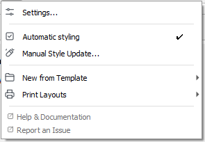
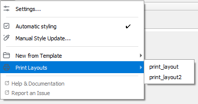

# Daglig brug

Når en konfiguration er indlæst, arbejder StyleCore side om side med normale QGIS-arbejdsgange. Du har **ikke** brug for Developer Mode for at bruge de fælles ressourcer.

{ width="36%" }
*StyleCore-menuen giver almindelige brugere hurtig adgang til indstillinger, Automatic Styling, templates, layouts og hjælp.*

## 1. Tjek din opsætning

1. Åbn **StyleCore → Settings…**.
2. Bekræft, at den rigtige konfiguration er aktiv.
3. Hvis du skal oprette eller reparere en konfiguration, se [Konfiguration – i QGIS](../documentation/configuration.md).

## 2. Tilføj lag og brug Automatic Styling

1. Sørg for, at **Automatic Styling** er slået til i StyleCore-menuen.
2. Tilføj et lag i QGIS som normalt.
3. Hvis der findes en matchende QML, bruger StyleCore den.
4. Hvis ingen regel eller matchende QML findes, beholder laget sit normale udseende.

## 3. Start et projekt fra en fælles template

{ width="45%" }
*Templates åbnes direkte fra StyleCore-menuen.*

1. Åbn **StyleCore → New from Template**.
2. Vælg en template.
3. Arbejd videre i det nye projekt.
4. Brug **Save As** til at gemme dit eget projekt under et nyt navn.

## 4. Tilføj et printlayout

{ width="45%" }
*Tilgængelige printlayouts vises direkte i StyleCore-menuen.*

1. Åbn **StyleCore → Print Layouts**.
2. Vælg et layout.
3. QGIS Layout Designer åbner med et nyt layout i dit projekt.

## 5. Brug din egen style eller opdater et eksisterende lag

- **Personal Override:** tildel din egen QML til et lagnavn i **Settings → Options → StyleCore → Personal Overrides**.
- **Manual Style Update…:** vælg et eksisterende lag og påfør en style bevidst.

Ingen af delene ændrer den fælles teamopsætning.

## 6. Få hjælp

Brug **StyleCore → Help & Documentation** eller **Report an Issue**, eller se [Fejlfinding](../documentation/troubleshooting.md).
