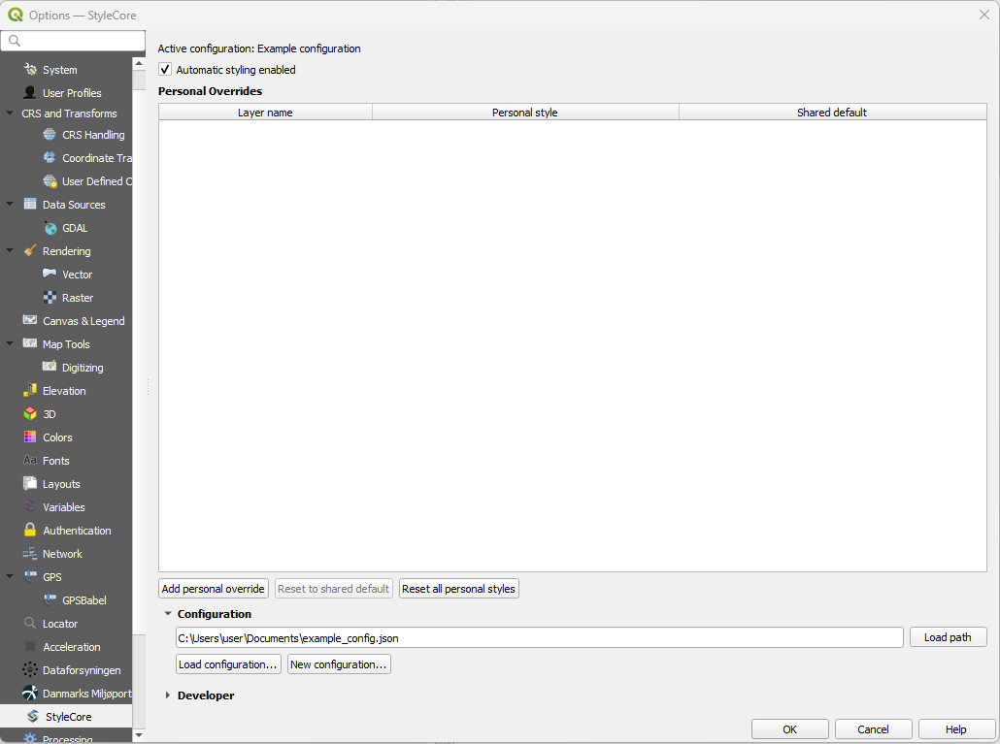
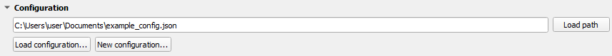

# Configuration – In QGIS

A configuration is the **JSON file** that tells StyleCore where to find shared styles, project templates, print layouts and optional fonts. This page explains the **practical workflow inside QGIS**. For the fields stored in the JSON itself, see [Configuration JSON](configuration-json.md).

{ width="100%" }
*The main StyleCore settings page in QGIS. Ordinary users mostly work with **Personal Overrides** and **Configuration**. Maintainers also use **Developer**.*

## 1. Load an existing configuration

Use this when a colleague has already created the shared setup.

1. Connect to the required shared drive, VPN or network location.
2. Open **Settings → Options → StyleCore**.
3. Expand **Configuration**.
4. Use **Load configuration…** and browse to the JSON file, or paste the full path in the field and click **Load path**.
5. Confirm the name under **Active configuration**.
6. Test the configuration from the StyleCore menu, for example **New from Template** or **Print Layouts**.

{ width="82%" }
*The Configuration section stores the path to the active JSON file and gives access to **Load configuration…** and **New configuration…**.*

!!! tip "Share a path, not separate copies"
    Colleagues should normally load the **same shared JSON file**. Shared behavior belongs in that file. Personal Overrides stay in each user's local QGIS profile.

## 2. Create a new configuration

Use this once when you are setting up StyleCore for a team or for yourself.

1. Open **Settings → Options → StyleCore → Configuration**.
2. Click **New configuration…**.
3. Enter a **Name**.
4. Choose the **Configuration file** path.
5. Decide how the resource root should work:
   - **Recommended:** keep **Use configuration file folder as resource root** enabled.
   - **Alternative:** disable it and choose a separate **Root folder**.
6. Keep or rename the three default resource folders: **Styles**, **Templates** and **Print layouts**.
7. Enter and confirm the **Developer code**.
8. Click **Save configuration**.
9. Put your actual resource files into the created folders.
10. Test the configuration and then share the JSON path with colleagues.

### Recommended: JSON folder also acts as resource root

{ width="78%" }
*This is the simplest and most portable setup. The JSON file and the resource folders live together.*

Typical structure:

```text
StyleCore/
├── office.json
├── layer_styles/
├── template_projects/
├── layouts/
└── fonts/                # optional, create manually if needed
```

### Alternative: separate resource root

{ width="78%" }
*Use this if the JSON file should live in one place but the shared resources should live somewhere else, for example on a dedicated drive or UNC path.*

This setup is useful when:

- the JSON file is distributed separately,
- the shared resources already exist in another folder,
- or the team wants to keep the configuration file and the actual resources apart.

## 3. Add or update shared resources

After creating the configuration, StyleCore creates the folder structure, but **not** the actual content. Add the resources yourself:

1. **Styles:** Put `.qml` files in the styles folder. If the layer name and QML filename differ, add rules in Developer settings. See [Layer Styling](layer-styling.md).
2. **Templates:** Put `.qgs` / `.qgz` files in the templates folder, or add external template references. See [Project Templates](project-templates.md).
3. **Print layouts:** Put `.qpt` files (and matching `.svg` files if used) in the layouts folder. See [Print Layouts](print-layouts.md).
4. **Fonts (optional):** Create a `fonts` folder at the root and add licensed `.ttf` / `.otf` files there.

## 4. Switch or reload a configuration

1. Return to **Settings → Options → StyleCore → Configuration**.
2. Load the required JSON file.
3. Confirm the active configuration name.
4. Test a known template, print layout or layer style.

Use this after a colleague changes shared settings or when you move between different office / field / test setups.

## 5. Move or rename a configuration or shared drive

1. Identify what changed:
   - the JSON file location,
   - the resource root location,
   - or referenced template / data paths.
2. If the JSON file folder is also the resource root, move the JSON **together with** its resource folders.
3. If the configuration uses a separate root folder, a maintainer must update that root in **Developer**.
4. Have each colleague reload the JSON if the JSON file path changed.
5. Test templates, styles, layouts and fonts afterwards.

See [Troubleshooting – Moved folders or network drives](troubleshooting.md#moved-folders-or-network-drives).

## 6. Maintain shared settings for a team

Ordinary users mainly need the configuration path. Maintainers also need **Developer Mode**.

{ width="82%" }
*Developer Mode unlocks the shared maintenance sections.*

Use Developer Mode when you need to:

- change the shared resource root,
- maintain shared layer rules,
- maintain File Suffix Rules,
- maintain template availability,
- or save shared QML styles.

Those tasks are described in detail in [Developer Tools](developer-tools.md) and [Configuration JSON](configuration-json.md).
