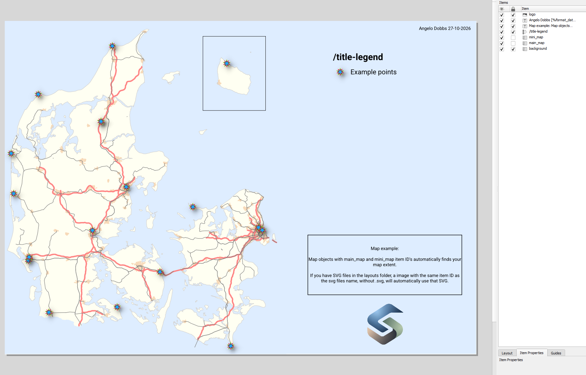
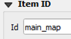
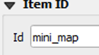
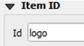

# Print Layouts

StyleCore opens shared QGIS layout templates (`.qpt`) from your configured `layouts` folder.

## 1. Open a layout

1. Set your map extent in QGIS.
2. Choose **StyleCore → Print Layouts** and select a layout.
3. A new layout opens in **QGIS Layout Designer**. Adjust it and export or print.

*Example of a shared layout opened through StyleCore.*

## 2. Create a layout template

1. In QGIS, choose **Project → New Print Layout** and add maps, legends and images.
2. Assign the Item IDs described below to any elements you want StyleCore to handle automatically.
3. Export as `.qpt` and save it in the shared `layouts` folder alongside any referenced SVG files.
4. Test the QPT through **StyleCore → Print Layouts**.

## 3. Item IDs

Assign Item IDs in **QGIS Layout Designer → Item Properties**. These names control how StyleCore fills or updates layout elements.

| Item ID | Example | What it does |
|---|---|---|
| `main_map` |  | Uses the current QGIS canvas extent for the main map and activates **Move Item Content** where supported. |
| `mini_map` |  | Also uses the current canvas extent, but does not automatically create an overview relationship. |
| `logo` |  | On a Picture item, loads an SVG file with the same basename from the layouts folder. |

## 4. SVG picture items

Assigning a correct Item ID, will make StyleCore look in the `layout` folder for a matching `.svg`. 
The **Picture Item ID** must match the SVG filename **without** `.svg`.

- `logo` → `logo.svg`
- `north_arrow` → `north_arrow.svg`
- `company_mark` → `company_mark.svg`

<figcaption>Use any SVG filename you want, as long as the Picture Item ID and SVG basename match exactly</figcaption>

## 5. Update an existing template

Edit the source layout, export a new `.qpt` to the shared folder, and test it by creating another layout through StyleCore. **Layouts already saved in projects are not replaced automatically.**

See [Configuration](configuration.md) for the resource folder and [Troubleshooting](troubleshooting.md) if files cannot be found.
