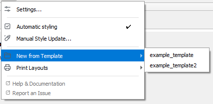

# Project Templates

A project template is a reusable **QGIS project (`.qgs` / `.qgz`)** with predefined layers, map settings and styling. StyleCore reads templates **directly from their source locations**; it does not copy them into each user's local QGIS template folder.

## 1. Open a template as a new project

1. Open **StyleCore → New from Template**.
2. Choose a template from the list.
3. StyleCore opens it as a **new, unsaved QGIS project**.
4. Make your changes.
5. Use **Save As** to save your own project under a new name.

This protects the shared original.

{ width="100%" }
*Users open templates from **StyleCore → New from Template**.*

## 2. Create a new shared template

1. Build the project you want to reuse.
2. Check that data sources, layers and defaults are suitable for colleagues.
3. Save it as `.qgs` or `.qgz` in the configured templates folder.
4. Organize templates in subfolders if needed.
5. Test the result from **StyleCore → New from Template**.
6. In Developer settings, confirm that the template is **Active** and decide whether it should use **Refresh**.

## 3. Link an external template

Use this when the template should stay outside the normal templates folder.

1. Open **Settings → Options → StyleCore**.
2. Enable **Developer Mode**.
3. In **Templates**, click **Add external template…**.
4. Enter a name and choose the `.qgs` / `.qgz` file.
5. Save with the developer code.
6. Test it from **New from Template**.

## 4. Control Active and Refresh

{ width="92%" }
*The Templates table is where maintainers decide which templates appear in the menu and which ones should refresh matching styles.*

| Active | Refresh | Result |
|---|---|---|
| On | Off | Shown in the menu and opened with its saved styles |
| On | On | Shown in the menu and opened with matching styles refreshed |
| Off | Either | Hidden from the menu |

1. Open **Developer → Templates**.
2. Find the template.
3. Tick **Active** if it should be visible.
4. Tick **Refresh** if matching styles should be reapplied when the template is opened through StyleCore.
5. Save with the developer code.

## 5. Update or move an existing template

1. Open the **source QGS / QGZ**, not somebody's saved project.
2. Make the changes and save the source file.
3. If the file was moved or renamed, update the reference in **Developer → Templates** if needed.
4. Test it from **New from Template**.
5. Use **Save As** for test output.

**Important:** Refresh only runs when the template is opened through **StyleCore → New from Template** and **Automatic Styling** is enabled.
