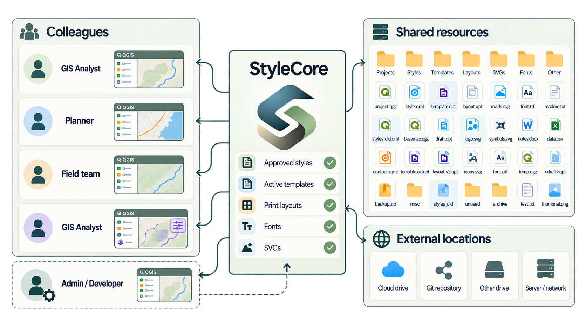

# All Features

StyleCore connects QGIS users to shared or local **styles, project templates, print layouts and optional fonts**. Shared resource folders help teams stay consistent as styles and templates evolve.

  

    <strong>Connect</strong>
    
Bring your team together through shared QGIS resources.

  

  

    <strong>Create</strong>
    
Build projects faster with ready-to-use styles, templates and layouts.

  

  

    <strong>Stay consistent</strong>
    
Keep every project aligned as your shared resources evolve.

  

This is a quick overview; each link leads to step-by-step instructions.

## Configuration

- Share a single config on a network drive (including UNC paths).
- Colleagues use the same shared configuration and can reload it when shared settings change.
- Create or load a JSON configuration directly inside QGIS.
- Keep JSON and resource folders together for a portable setup, or use a separate resource root.
- Keep shared rules in JSON while personal preferences remain local.

[Set up Configuration →](../documentation/configuration.md) · [Configuration JSON fields →](../documentation/configuration-json.md)

## Layer Styling

- Automatically apply QML styles to **newly added** layers.
- Match by **visible layer name**, **shared layer rule**, **File Suffix Rule**, or **Personal Override**.
- Keep personal QML choices local with **Personal Overrides**, without changing the shared setup.
- Toggle Automatic Styling from the StyleCore menu.
- Apply QML manually to a selected **existing** layer without creating a shared rule.
- Save selected project-layer styles to shared QMLs with Developer Mode.

[Use and maintain Layer Styling →](../documentation/layer-styling.md)

## Project Templates

- Open shared `.qgs`/`.qgz` files **directly**, without local template copies.
- Find templates in the configured root **and subfolders**.
- Link **external templates** located elsewhere.
- Configure **Active** (shown in menu) and **Refresh** (reapply matching QML on opening) separately.
- Start new, unsaved projects from templates to protect the shared originals.

[Create and maintain Project Templates →](../documentation/project-templates.md)

## Print Layouts

- Open shared `.qpt` files from the StyleCore menu.
- Initialize `main_map` and `mini_map` from the current QGIS canvas.
- Activate **Move Item Content** for `main_map` where supported.
- Match SVGs to layout Picture items by **Item ID** — for example `logo` → `logo.svg` or `north_arrow` → `north_arrow.svg`.
- Create multiple layouts without overwriting existing layouts.

[Create and maintain Print Layouts →](../documentation/print-layouts.md)

## Fonts, maintenance and support

- Optionally register `.ttf`/`.otf` fonts from `root/fonts` in QGIS.
- Use **Developer Mode** for shared settings and QML saves, with code confirmation and filesystem permissions.
- Help and issue links are available directly from the StyleCore menu.

[Developer Tools →](../documentation/developer-tools.md) · [Troubleshooting →](../documentation/troubleshooting.md)
