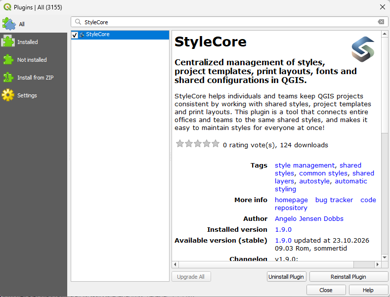

# Installation

Install StyleCore in QGIS first. You can then load your team's shared configuration or create your own.

## 1. Check the requirements

- **QGIS 3.44 or later.** StyleCore 1.9.0 declares compatibility with QGIS 3.44 and 4.x.
- Access to a network drive or other shared data sources **only if your team's configuration uses them**.

<figure><figcaption>StyleCore in the official QGIS Plugin Manager (already installed).</figcaption></figure>

## 2. Install from QGIS (recommended)

StyleCore is available in the [official QGIS Plugin Repository](https://plugins.qgis.org/plugins/StyleCore/). This is the simplest way to install the plugin and receive updates.

1. Open QGIS and go to **Plugins → Manage and Install Plugins…**.
2. Select **All** and search for **StyleCore**.
3. Select **StyleCore** and click **Install Plugin**.
4. Close the plugin manager. Open the **StyleCore** toolbar menu to get started.

!!! tip "Cannot find StyleCore?"
    Make sure the official QGIS plugin repository is enabled in the **Settings** tab of the plugin manager and that QGIS has internet access. Check your QGIS version if the plugin is still not listed.

## 3. Alternative: install a ZIP from GitHub

Use this method when you prefer a manual installation or cannot use the plugin catalogue.

1. Open the [latest StyleCore release on GitHub](https://github.com/vnaru42/StyleCore/releases/latest).
2. Under **Assets**, download the release file named **`StyleCore_vX.Y.Z.zip`** (use the current version).
3. In QGIS, open **Plugins → Manage and Install Plugins… → Install from ZIP**.
4. Select the downloaded ZIP and click **Install Plugin**.
5. Open the **StyleCore** toolbar menu.

!!! warning "Choose the plugin ZIP, not the source-code ZIP"
    GitHub's automatically generated **Source code (zip)** archive is not the packaged QGIS plugin. Download the **StyleCore_vX.Y.Z.zip** file under the release's Assets instead. You do not need to extract the plugin ZIP before installing it.

!!! note "Plugin and configuration are separate"
    Installing StyleCore does not include your organization's shared QML styles, project templates, print layouts or JSON configuration. Load or create a configuration after installing the plugin.

## 4. Continue

[First Use →](first-use.md){ .md-button .md-button--primary }
