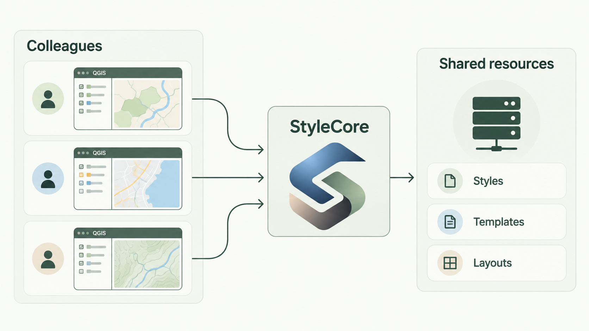

---
hide:
  - toc
---

User Guide

# StyleCore — a common home for QGIS styles, templates and layouts.

StyleCore helps individuals and teams keep QGIS projects consistent by working with shared styles, project templates and print layouts.

## A simpler everyday workflow

<strong>01 · Connect</strong>
Load or create a JSON configuration that points to your local or shared resource folders.

<strong>02 · Work</strong>
Use styles, templates and print layouts from the StyleCore menu and QGIS settings.

<strong>03 · Stay consistent</strong>
Keep configured project templates and layer styles up to date as resources change.

 

<a class="sc-card" href="getting-started/installation/">
↓
<h3>Install</h3>

Get StyleCore running in QGIS using the downloadable plugin ZIP.

</a>
<a class="sc-card" href="getting-started/basic-usage/">
◈
<h3>Use</h3>

Load a configuration and start using shared QGIS resources.

</a>
<a class="sc-card" href="features/feature-reference/">
▦
<h3>Explore</h3>

See what StyleCore offers without reading technical setup details.

</a>

